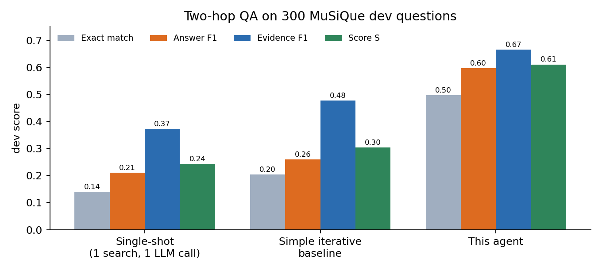
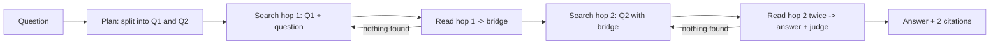
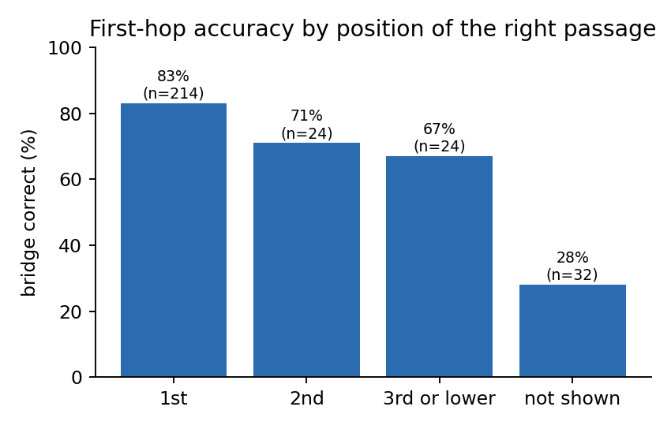
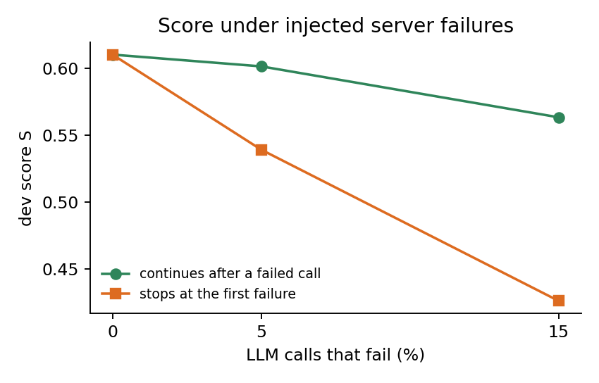
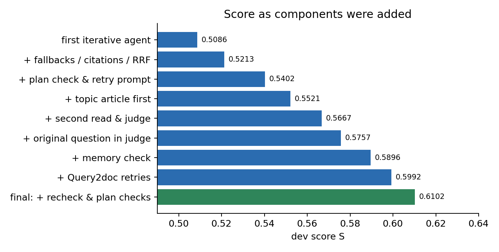
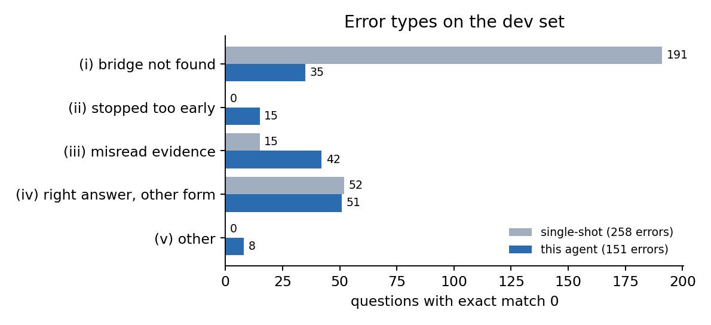

# BridgeHop: a budgeted agent for two-hop question answering

BridgeHop answers questions that need two facts from two different documents, such as
*"When did trolley buses stop running in the birthplace of George Shipley?"*. A single search cannot find the
second document, because it is about an entity the question never names (here, Shipley's birthplace). BridgeHop
first finds that linking entity, the **bridge**, then searches again with it, and spends whatever budget is left
on checking its answer.

Everything runs under a strict per-question budget: **5 BM25 searches, 6 calls to a small 4B LLM, 3,000 prompt
tokens per call and 60 seconds**. Within that budget BridgeHop is **2.5x better than single-shot retrieval** on
300 MuSiQue dev questions.



| System | Exact match | Answer F1 | Evidence F1 | Score S | Searches | LLM calls |
|---|---|---|---|---|---|---|
| Single-shot (1 search, 1 LLM call) | 0.1400 | 0.2110 | 0.3717 | 0.2431 | 1.00 | 1.00 |
| Simple iterative baseline | 0.2033 | 0.2596 | 0.4767 | 0.3030 | 2.03 | 3.03 |
| **BridgeHop** | **0.4967** | **0.5965** | **0.6650** | **0.6102** | 4.38 | 5.25 |

*S = 0.8 x answer F1 + 0.2 x evidence F1. Evidence F1 measures whether the cited passages are the two gold
supporting paragraphs. Searches and LLM calls are means per question.*

---

## How it works



**1. Planning.** One LLM call rewrites the question as two single-hop questions: Q1 asks for the bridge and Q2 refers
to Q1's answer as `#1` (*"Where was George Shipley born?"*, *"When did trolley buses stop running in #1?"*). Bad
plans are caught by simple checks and re-asked with a second prompt: Q2 without `#1`, a Q1 that repeats the question,
a Q1 that asks for a date or number (the bridge is always an entity), or a Q1 that loses every name in the question.
If both attempts fail, a possessive (*X's team*) or *the Y of X* phrase is split off without the LLM.

**2. Retrieval (`next_query`).** Hop 1 searches BM25 with Q1 and with the full question; hop 2 with Q2 (bridge
filled in) and with the bridge plus the question. Each hop's result lists are merged with reciprocal rank fusion.
When a read finds nothing, the next query depends on what failed: hop 1 adds the first sentence of a short passage the
LLM writes as a guess (Query2doc), hop 2 searches for the bridge's own article. If the bridge still cannot be found,
the model's own knowledge supplies it and hop 2 continues as usual.

**3. Reading and verification.** The LLM reads 10 whole passages at hop 1 and 12 at hop 2. A 4B model reads the
first passages best, so the article named in the question is always shown first:



A bridge taken from a lower passage is checked again after a Query2doc search. The hop-2 answer is read a second time
with the passages reversed and the original question; if the two answers differ, a judge call compares them with
their passages and keeps the first when unsure. With a call to spare, the model also answers without passages, and
the judge decides again if a retrieved passage supports that answer.

**4. Stopping and answering (`should_stop`, `answer`).** The search stops once hop 2 has an answer of the expected
type (a date for *when*, a number for *how many*) that is not the bridge itself, or when only one LLM call or 15 s
remain. If hop 2 never answered, the model guesses with the bridge as a hint, with a rejected answer of the right type
or a span from the best passage as fallbacks. Two passages are cited: one with the bridge and one with the answer.

**5. Robustness.** Every step checks the remaining budget, and a failed LLM call never ends a question: a failed plan
tries the other prompt and a failed read counts as a failed attempt. With a healthy server this changes nothing; when
calls fail, it keeps most of the score:



## How it improved

Each bar is the dev score after a group of components was added:



The biggest single gains came from the second read with a judge, from putting the topic article first, and from
Query2doc retries. With only six LLM calls, spending a call on checking an answer paid off more than spending it on
finding more passages.

**What did not help**

| Idea | Effect on S | Why |
|---|---|---|
| Three hop-2 searches at the start instead of two | -0.022 | the retry after a failed read lost its search |
| Asking the reader to copy the answer word for word | -0.049 | the model picked the wrong facts more often |
| Quoting the evidence before answering | -0.010 | longer outputs, more reading mistakes |
| Query2doc for every question | worse | used the calls the judge needed |
| 14 passages at hop 2, a third citation | no gain | more noise for the reader |

## Where it still fails



Iterating cuts bridge failures from 191 to 35. Most remaining errors are reading mistakes with the right paragraphs
in hand, or answers that are right in another form (*August 5, 1940* vs *5 August 1940*). With the right bridge and
the second paragraph retrieved, answer F1 is 0.76; with a wrong bridge and no second paragraph it drops to 0.14.

---

## Running it

**Requirements:** Python 3.10+, `numpy`, `requests`, and an OpenAI-compatible LLM server such as vLLM
(developed with Qwen3-4B-Instruct).

```bash
git clone https://github.com/AdityaCodeSphere123/COL764-Assignment4.git bridgehop
cd bridgehop
python3 -m venv .venv && source .venv/bin/activate
pip install -r requirements.txt
```

**Data.** The agent expects a MuSiQue-style corpus with a prebuilt BM25 index (the data files are not included in
the repository):

```
data/corpus.jsonl     # paragraphs: {"doc_id", "title", "text"}
data/bm25/            # BM25 index (build it with: python build_index.py --data-dir data)
data/dev.jsonl        # questions with gold answers and supporting doc_ids
```

**LLM endpoint.** Create `config.json` (it is git-ignored, so your key stays local):

```json
{
  "llm_base_url": "http://localhost:8000",
  "llm_model": "your-model-name",
  "llm_api_key": "YOUR_KEY",
  "token_count": "server",
  "extra_body": {}
}
```

Use `"token_count": "approx"` if your server has no `/tokenize` endpoint.

**Run.**

```bash
python run_dev.py --mock-llm --limit 5      # offline smoke test, no LLM needed (scores are meaningless)
python run_dev.py --question "Who is the spouse of the Green performer?"   # one question with a full trace
python run_dev.py --limit 50                # first 50 dev questions
python run_dev.py                           # full dev set
python dev/analyze.py runs/<run-folder>     # retrieval diagnostics and labelled errors
python dev/make_figures.py                  # regenerate the figures in docs/figures/
```

Each run writes `runs/<timestamp>/` with `metrics.json` (scores), `predictions.jsonl` (answers and citations),
`traces.jsonl` (every search query and LLM prompt) and `review.jsonl` (questions sorted worst first).

## Project layout

| Path | Contents |
|---|---|
| `agent.py` | the agent: planning, `next_query`, `should_stop`, `answer` |
| `a4/` | framework: BM25 search, budgeted tools, LLM client, scorer |
| `run_dev.py` | runs the agent on the dev set and scores it |
| `dev/analyze.py` | error analysis: retrieval diagnostics, bridge accuracy, error categories |
| `dev/make_figures.py` | figures for this README |
| `dev/exp/crun.py` | runs the dev set with a disk cache of LLM replies (repeat runs cost no tokens) |
| `dev/exp/replay.py` | scores agent changes offline from the cache, with zero LLM calls |
| `dev/b1_agent.py` | the single-shot baseline used for comparison |
| `report/` | the write-up (LaTeX) |

## Credits

The search/LLM/scoring framework in `a4/` and the BM25 index come from the Information Retrieval course (COL764)
at IIT Delhi. Data: MuSiQue (Trivedi et al., TACL 2022). The loop follows IRCoT (Trivedi et al., ACL 2023) and
ReAct (Yao et al., ICLR 2023); rank fusion follows Cormack, Clarke and Buettcher (SIGIR 2009); query expansion
follows Query2doc (Wang et al., EMNLP 2023).
